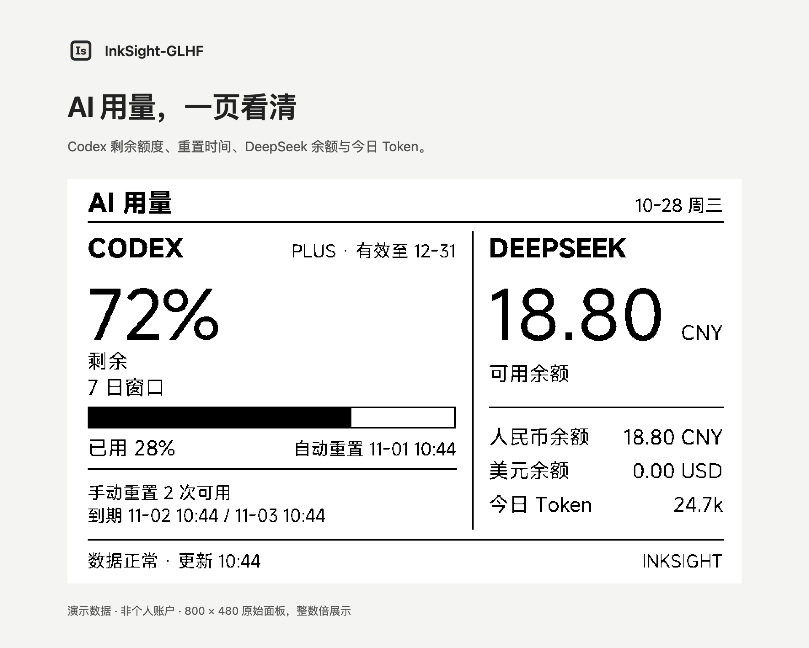
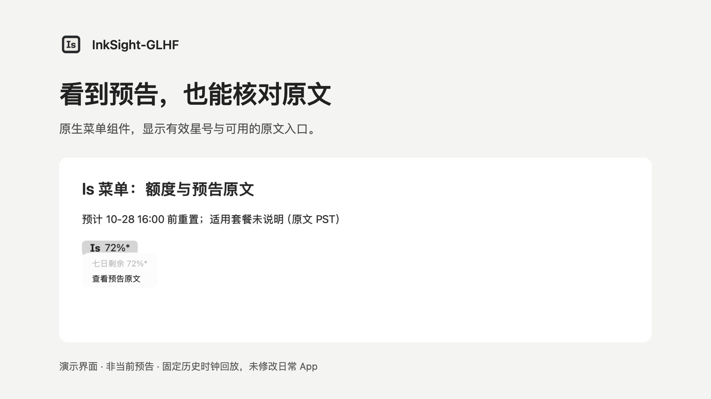
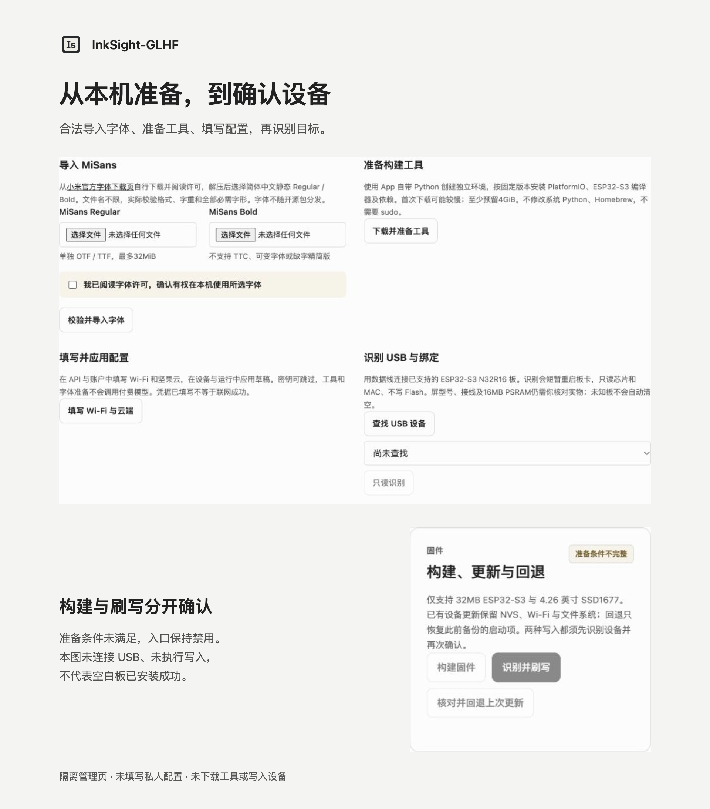

# InkSight-GLHF

[中文](README.md) · [Documentation](docs/README.md) · [test.18 notes](docs/releases/v0.1.0-test.18.en.md)

**A macOS menu-bar app and ESP32-S3 e-paper dashboard.** Keep AI usage, technology briefs and gold prices beside your desk. Use Is to manage local services, inspect quota and optionally follow experimental reset announcements.

**[Download Mac App · Apple Silicon](https://github.com/NuoYe-CCnC/InkSight-GLHF/releases/download/v0.1.0-test.18/InkSight-macOS-arm64.zip)** · [Prerelease and checksums](https://github.com/NuoYe-CCnC/InkSight-GLHF/releases/tag/v0.1.0-test.18)

Requires **Apple Silicon and macOS 26.5+**; actually tested on 26.5.2. CPython 3.11.15 is bundled. This is a public test release, ad-hoc signed and **not Developer ID signed or Apple-notarized**. The physical display also requires supported hardware, wiring and a local firmware build. No generic ready-to-flash firmware is distributed.

## Interface previews

These are **demo data / historical replay**, produced by the test.18 renderer and isolated UI. They are not personal account data, live market quotes or a current announcement. Briefs are original project demo text. Open each image at full size; the two panel pages retain their 800×480 originals.

AI usage: available windows, reset timing and project token use. [800×480 original](docs/images/ai-usage-800.png)

Today: briefs, usage and spot-gold conversion on one page. [800×480 original](docs/images/today-brief-800.png)

Is: an active announcement adds a star and a source link. This replay is not a current forecast.

Preparation: visible steps and prerequisites. No USB write was performed for this image; it is not a fresh-board installation result.

## Get started in three steps

1. **Download and open the App.** Verify the matching SHA256 using the [download guide](docs/DOWNLOAD.zh-CN.md). Keep the complete App at your chosen install path. Is → “打开配置” opens a protected local session without a root account or password.
2. **Configure and prepare.** Enter Wi-Fi, WebDAV and chosen services. Obtain MiSans legally from Xiaomi, import it locally and explicitly prepare the toolchain in the [graphical preparation center](docs/DEVICE_FIRST_USE.zh-CN.md). Remote news and experimental announcements default to off. Without enabled news sources and keys, local messages are used without automatic paid model calls.
3. **Confirm the device, then build and flash.** Check [hardware and wiring](docs/INSTALLATION.zh-CN.md). Fresh-board installation and existing-device updates are separate flows. Supported updates back up state and write the inactive application slot. App-only changes do not require reflashing for matching version numbers; **full test.18 v2 announcement support needs compatible firmware**. See [upgrade guidance](docs/UPGRADE.zh-CN.md).

## Hardware and runtime

| Area | Supported scope and original references |
|---|---|
| Controller | ESP32-S3-DevKitC-1-N32R16V / ESP32-S3-WROOM-2-N32R16V, 32 MB Octal flash and 16 MB Octal PSRAM; [Espressif guide](https://docs.espressif.com/projects/esp-dev-kits/en/latest/esp32s3/esp32-s3-devkitc-1/user_guide_v1.0.html) |
| Display | Waveshare 4.26-inch monochrome SSD1677, 800×480; [product](https://www.waveshare.com/product/displays/e-paper/4.26inch-e-paper-hat.htm), [original manual](https://www.waveshare.com/wiki/4.26inch_e-Paper_HAT_Manual) |
| Firmware | Only `epd_426_ssd1677_s3_n32r16`; other historical environments are not qualified hardware |
| Host | Apple Silicon / macOS 26.5+ App; the Mac must stay awake and connected for scheduled collection and publication |

Other macOS versions, Intel, Windows and Linux have not received equivalent qualification. A one-week runtime for `2000 mAh` has not been measured to a release-quality protocol. See the [support matrix](docs/SUPPORT_MATRIX.md).

## Data, announcements and defaults

- **All remote news sources are disabled** in a fresh install; operators review terms before enabling each. Experimental announcements are also off by default. Existing switches survive upgrades.
- Available local Codex windows are separate from OpenAI API billing. Optional API monthly spend is the selected organization's **UTC calendar month** cost, not an API balance. DeepSeek daily tokens combine project observations and balance-based estimates under documented rules, not an official whole-account ledger. Unknown values stay `--`. [Configuration semantics](docs/CONFIGURATION.zh-CN.md)
- test.18 handles bounded author replies/series, midnight and unknown times, Beijing-time display, original-source links and source diagnostics. Sources can change or be incomplete; **there is no guarantee of advance notice, personal eligibility or delivery**. Announcements never change actual quota, reset counts or page switching. [Announcement v2](docs/CODEX_FORECAST_V2.zh-CN.md)
- Is shows the rounded remaining percentage from a valid local Codex 7D cache, or `-` when unavailable. Active experimental announcements add `*`. Closing a window leaves the backend running; quit through Is. Standalone source deployments create their own administrator and have **no default username or password**. [Menu/session guide](docs/MENU_BAR.zh-CN.md)

This is **not an official product** of OpenAI, DeepSeek, Xiaomi or a hardware vendor. Private configuration, keys, device identifiers, ledgers and runtime state are excluded. [Report security issues privately](SECURITY.md).

## Validation, source and license

The feature candidate passed **646 tests, zero skipped**, with one existing Dashscope deprecation warning. Final publication rechecks are recorded in the [test.18 notes](docs/releases/v0.1.0-test.18.en.md). Local App migration and single-instance operation, an existing-board inactive-slot upgrade/full readback/network receipt, and preservation of two Wi-Fi profiles passed; the user confirmed a refreshed footer and normal display. Fresh-board installation, a second Mac/Gatekeeper, real rollback, next-login startup, all physical screen states and long-duration page switching remain separately unverified.

For development, download [InkSight-Source.zip](https://github.com/NuoYe-CCnC/InkSight-GLHF/releases/download/v0.1.0-test.18/InkSight-Source.zip); it is not an installer. See [contributing](CONTRIBUTING.md), [source setup](docs/FIRST_USE.zh-CN.md) and the [documentation index](docs/README.md).

Project-owned code and four release messages use [`GPL-3.0-only`](LICENSE). Third-party code, fonts, news and services keep their own terms. Neither MiSans files nor generated glyph data are distributed in the repository, App source template or source ZIP. The previews are raster output, not font files. See [license scope](LICENSE-SCOPE.md), [third-party notices](THIRD_PARTY_NOTICES.md), [image provenance](docs/images/README.md) and [SBOM](SBOM.json).
